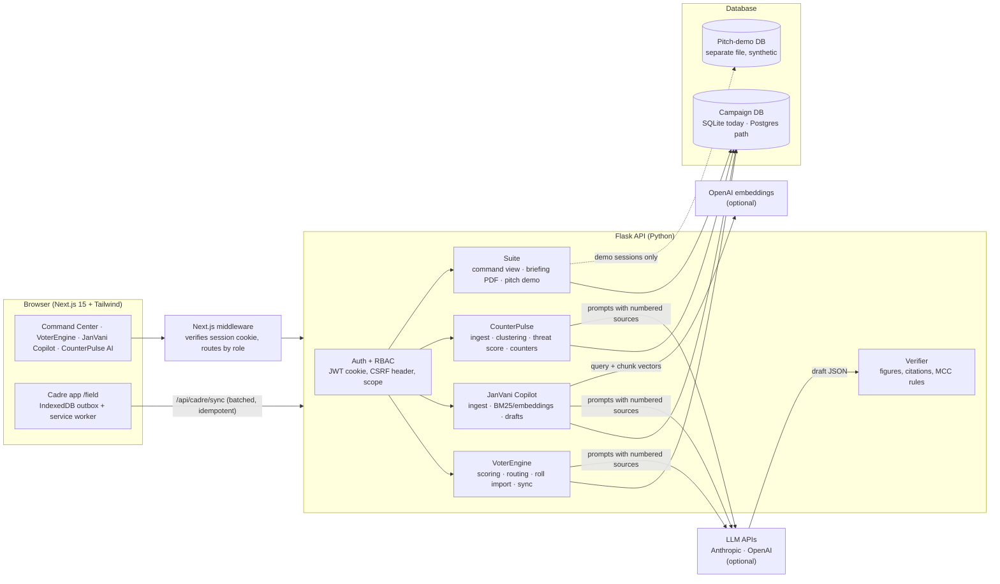

# Jarvis Election Intelligence Suite

One platform for running a state election campaign in Uttar Pradesh, Punjab, Uttarakhand and Goa:

| Product | Route | Who uses it | What it does |
|---|---|---|---|
| **Command Center** | `/dashboard` | Strategists, constituency managers | One executive view across all three products: headline numbers per state, quick actions, and a 2-page Executive Briefing PDF |
| **VoterEngine AI** | `/` and `/field` | Strategists, managers, field cadres | Swing and turnout scoring, voter segments, booth priorities, cadre walking routes, an offline-first cadre app with doorstep consent |
| **JanVani Copilot** | `/copilot` | Strategists, managers | Speeches, briefings and local manifestos drafted from the constituency's own documents, with a source for every figure |
| **CounterPulse AI** | `/warroom` | Strategists, managers | Media monitoring across TV, print, YouTube and social, narrative threat scores, and fact-checked counter-responses with an ECI/MCC safety check |

It runs on synthetic data out of the box. Real electoral rolls, documents, media and LLM keys plug in without code changes ([Going live](#going-live-from-synthetic-data-to-real-data)). A one-click **pitch demo** loads a separate, fully synthetic workspace for presentations ([Pitch demo](#pitch-demo-five-minute-presentation)).

```
voterengine-ai/
├── backend/                 Flask + SQLite (Python 3.10+)
│   ├── schema.sql           Database schema
│   ├── app/
│   │   ├── config.py        State profiles: weights, schemes, thresholds  ← tune here
│   │   ├── generator.py     Mock data generator (booths → households → voters)
│   │   ├── scoring.py       Swing + turnout scoring, quadrant classifier
│   │   ├── routing.py       Household roll-up, k-means clusters, NN + 2-opt routes
│   │   ├── talking_points.py  Rule-based recommender (pluggable provider)
│   │   ├── ingestion.py     CSV / JSON normalisation + validation
│   │   ├── auth.py          JWT sessions, password hashing, RBAC decorators, scope
│   │   ├── privacy.py       DPDP layer: PII masking, consent state + log, audit log
│   │   ├── scoring_config.py  Admin weight overrides + background re-score jobs
│   │   ├── sync.py          Idempotent offline-sync for the cadre app
│   │   ├── electoral_roll.py  Roll import: header mapping, validation, de-duplication, roll-only upsert
│   │   ├── knowledge.py     Knowledge base, daily directives, TF-IDF retriever
│   │   ├── knowledge_seed.json  Starter briefs (replace with verified campaign material)
│   │   ├── llm.py           Anthropic / OpenAI providers over stdlib HTTP; offline when no key
│   │   ├── talking_points.py  Prompt builder, guardrails, cache, offline generator
│   │   ├── ops.py           Cadre operations analytics + Daily Booth Summary CSV/PDF
│   │   ├── copilot/         JanVani Copilot
│   │   │   ├── kb.py        Ingestion (PDF/TXT/MD/JSON), metadata detection, chunking, hybrid BM25 + embedding search
│   │   │   ├── generate.py  Grounded answers, speech/briefing documents, micro-manifestos; citation + figure verification
│   │   │   ├── export.py    Markdown and PDF exports
│   │   │   └── seed.json    Synthetic sample corpus (labelled SAMPLE; delete before real use)
│   │   ├── warroom/         CounterPulse AI
│   │   │   ├── engine.py    Media ingestion, PII scrub, sentiment, issue detection, clustering, threat scoring
│   │   │   ├── counter.py   Counter-response generator: KB retrieval, LLM draft, verification, ECI/MCC safety check
│   │   │   ├── export.py    Markdown and PDF counter-briefs
│   │   │   └── seed.py      Synthetic sample media feed + "simulate feed" (channels marked "sample")
│   │   ├── suite/           Integration layer
│   │   │   ├── command.py   Command Center read model (aggregates only) + route dispatch
│   │   │   ├── briefing.py  2-page Executive Briefing PDF (ReportLab)
│   │   │   ├── pitch.py     One-click pitch demo: builds the separate synthetic workspace
│   │   │   └── pitch_corpus.json  Extra synthetic documents for all four states (labelled SAMPLE)
│   │   ├── db.py            SQLite access layer, workspaces (real / pitch demo), additive migrations
│   │   └── main.py          REST API (every route role-checked)
│   ├── scripts/seed.py      Regenerate mock data + demo logins
│   ├── scripts/create_user.py  Create real logins
│   ├── scripts/readiness.py    Go-live check: configuration, demo logins, synthetic data; removes sample material
│   ├── sample_data/voters_template.csv
│   ├── sample_data/electoral_roll_sample_{en,hi}.csv, electoral_roll_parser_output.json
│   └── tests/               98 tests: pipeline, auth/RBAC, sync, privacy, recalibration, roll import, talking points, ops, copilot, war room, suite
└── frontend/                Next.js 15 + Tailwind v4 + Leaflet
    ├── middleware.ts        Verifies the session cookie, routes each role
    ├── app/                 /dashboard (Command Center), / (VoterEngine), /field (cadre app), /copilot, /warroom, /login
    ├── components/command/  CommandApp (KPIs, quick actions, state table, product panels)
    ├── components/DemoMode.tsx  "Pitch demo" switch and the PITCH DEMO ribbon
    ├── components/warroom/  WarRoomApp, NarrativeMonitor, Workbench, MediaLog, AddMedia, shared (threat badges, copy text)
    ├── components/copilot/  CopilotApp, BriefGenerator, ManifestoGenerator, KnowledgeManager, shared (citations, exports)
    ├── components/dashboard/  Dashboard, CadreOps, RollImport, ImportPanel, QuadrantField, ClusterMap, BoothTable, SegmentTable, VoterTable, CadrePanel
    ├── components/admin/      ScoringConfigModal, PrivacyPanel
    ├── components/field/      FieldApp, StopCard, SyncStatus, useFieldRoute (offline-first), useTalkingPoints
    ├── lib/                 api client, auth context, types, offline/ (IndexedDB outbox)
    └── public/sw.js         Service worker: opens /field with no connection
```

## Architecture



```
 Browser ──► Next.js (pages + middleware) ──/api proxy──► Flask API ──► SQLite (campaign)   ──► Postgres when scaling out
                                                              │   └──► SQLite (pitch demo, separate file, synthetic)
 Cadre phone (offline outbox) ──/api/cadre/sync──────────────┤
                                                              └──► Anthropic / OpenAI (optional) ──► verifier ──► saved draft
```

- **One API, three products.** The Flask service modules have no web-framework dependency. `main.py` holds the routes, and every route checks the caller's role and area (strategist: all states; manager: one constituency; cadre: their own route).
- **LLMs are optional and never trusted blindly.** Prompts carry numbered sources (`S1…Sn`). Every reply is checked: figures must appear in a source, citations must exist, and caste/religion appeals, personal attacks and inducements are removed. Without a key, each feature uses an offline generator that produces the same structure from the sources.
- **Personal data stays server-side.** The Command Center, briefing PDF, LLM prompts and exports use aggregates or household-level context only. PII masking is on by default.
- **Two workspaces.** The campaign database is never touched by the pitch demo, which lives in its own file (`<db>-pitch-demo.db`) and only affects the browser session that switched into it.
- **Scaling.** SQLite in WAL mode is fine for one API process. To run several processes, move to Postgres (only `db.py` and the SQL change) and put the login throttle and job lock on a shared store such as Redis.

## Setup

```bash
# 1. Backend  → http://localhost:8000
cd backend
python -m venv .venv && source .venv/bin/activate     # Windows: .venv\Scripts\activate
pip install -r requirements.txt
python -m app.main            # creates data/voterengine.db, seeds ~10k mock voters and demo logins
python -m pytest -q           # 98 tests

# 2. Frontend → http://localhost:3000
cd ../frontend
cp .env.example .env.local    # JWT_SECRET must match the backend's VOTERENGINE_JWT_SECRET
npm install
npm run dev                   # /api/* is proxied to :8000 (see next.config.mjs)
```

Open `http://localhost:3000`: you'll land on `/login`, which has one-click demo roles. Demo password for every seeded account is `voterengine`. Strategists and managers start on the **Command Center** (`/dashboard`); cadres go straight to `/field`. To present, flip **Pitch demo** in the top bar ([Pitch demo](#pitch-demo-five-minute-presentation)).

| Username | Role | Sees |
|---|---|---|
| `admin` | Central Strategist | All four states, imports, scoring weights, privacy settings, audit log |
| `mgr.sardhana` (one per constituency, e.g. `mgr.dhuri`, `mgr.margao`) | Constituency Manager | Their constituency's booths, voters, booth ranking, cadre assignment |
| `cad-up-sar-001` (one per cadre, e.g. `cad-pb-san-002`) | Field Cadre | `/field` only: today's route, offline sync, consent capture |

Regenerate mock data with `python -m scripts.seed --seed 7`. Upgrading a v1 database is automatic: new columns are added on start-up and demo logins are created if none exist.

### Environment

| Variable | Where | Default | |
|---|---|---|---|
| `VOTERENGINE_JWT_SECRET` | backend | dev constant | **Required in production** (startup fails without it). 32+ random bytes. |
| `JWT_SECRET` | frontend | same dev constant | Must equal the backend secret; middleware verifies cookies with it |
| `VOTERENGINE_ENV` | backend | `development` | `production` disables demo users and forces secure cookies |
| `VOTERENGINE_JWT_TTL_HOURS` | backend | `12` | Session length (one field day) |
| `VOTERENGINE_TZ` | backend | `Asia/Kolkata` | Defines "today" for cadre routes |
| `CORS_ORIGIN` | backend | `http://localhost:3000` | Only needed if the browser calls the API directly |
| `NEXT_PUBLIC_DEMO_LOGINS` | frontend | off in production | Set `1` to show demo-role shortcuts in a production build |
| `ANTHROPIC_API_KEY` / `OPENAI_API_KEY` | backend | unset | Enables AI talking points. Without a key, the offline generator is used |
| `VOTERENGINE_LLM_PROVIDER` | backend | `auto` | `auto` (Anthropic if its key is set, else OpenAI, else offline), `anthropic`, `openai`, `mock` |
| `VOTERENGINE_LLM_MODEL` | backend | `claude-haiku-5-5` / `gpt-4o-mini` | Override the model; check your provider's current model list |
| `ANTHROPIC_BASE_URL` / `OPENAI_BASE_URL` | backend | provider default | Route LLM calls through a gateway or proxy |
| `VOTERENGINE_EMBEDDINGS` | backend | `auto` | Copilot vector search: `auto` uses OpenAI embeddings when `OPENAI_API_KEY` is set; `off` keeps keyword (BM25) only |
| `VOTERENGINE_EMBEDDING_MODEL` | backend | `text-embedding-3-small` | Embedding model for Copilot search |
| `VOTERENGINE_PDF_FONT` | backend | DejaVu Sans if installed | TTF used for Copilot PDF exports (₹ and typographic quotes) |
| `VOTERENGINE_DB` | backend | `data/voterengine.db` | Campaign database; the pitch demo uses `<name>-pitch-demo.db` beside it |
| `VOTERENGINE_PITCH_DEMO` | backend | on (off in production) | `0` disables the pitch demo; `1` allows it in production |
| `VOTERENGINE_COOKIE_SECURE` | backend | `1` in production | Session cookie only over HTTPS |
| `VOTERENGINE_DEMO_PASSWORD` | backend | `voterengine` | Password for seeded demo logins (development and pitch demo only) |
| `VOTERENGINE_LLM_TIMEOUT` | backend | `15` | Seconds before an LLM call falls back to the offline generator |
| `API_ORIGIN` | frontend | `http://localhost:8000` | Where Next.js proxies `/api` |

Create real accounts with `python -m scripts.create_user <username> --role MANAGER --state UP --constituency Hapur --name "…"`.

## Pitch demo (five-minute presentation)

**Turn it on.** Sign in as the strategist and flip **Pitch demo** in the top bar. In about a second the browser switches into a separate synthetic workspace, and an amber **PITCH DEMO** ribbon stays on every page. The real campaign database is not touched, and other users (including cadres syncing from the field) carry on with real data. **Reset demo data** in the ribbon rebuilds it before each pitch. **Exit demo** returns you to your real session.

**What it loads** (`app/suite/pitch.py`, offline, no LLM cost):

| Product | Demo data |
|---|---|
| VoterEngine AI | About 10,000 scored synthetic voters, 24 booths and 24 cadres across all four states. Today's routes are dispatched for 20 cadres with a morning of door-to-door progress and doorstep consents, replayed through the real sync path. |
| JanVani Copilot | The sample corpus plus local records and party commitments for every state, with a saved local manifesto and a speech brief for Sardhana, Sangrur, Pauri and Margao. |
| CounterPulse AI | A 40-item media feed (TV, print, YouTube, social) forming narratives at every severity, with approved and draft counter-briefs. |
| Field directives | Today's focus for each state. |

**A five-minute run-through:**
1. **Command Center, all states** (1 min): four headline numbers, then the By-state table. Click **Uttar Pradesh** to scope it.
2. **Dispatch cadre routes** (30 s): four cadres have no route yet. One click builds their walking routes, and the field progress updates.
3. **Draft rally speech** (1.5 min): opens JanVani Copilot on the constituency with the most persuadable voters and drafts the speech. Click a citation chip to show its source.
4. **Counter viral threat** (1.5 min): opens CounterPulse AI on the top Critical narrative and drafts a TV brief. Walk through the four sections and the safety check, then approve it.
5. **Executive briefing (PDF)** (30 s): the 2-page briefing for the room, watermarked PITCH DEMO.

The demo is available to strategists in development and staging. On a production server it is off unless `VOTERENGINE_PITCH_DEMO=1`; set `VOTERENGINE_PITCH_DEMO=0` to turn it off anywhere. APIs: `GET /api/demo/status`, `POST /api/demo/pitch {"enabled": true | false, "rebuild": true}`, `POST /api/demo/exit`.

## Command Center and Executive Briefing

**`/dashboard`** is the home page for strategists and managers. Strategists switch between All states, UP, Punjab, Uttarakhand and Goa; managers see their own constituency. It shows:
- **Headline numbers:**
  - Active booths, and how many have cadres in the field today
  - Priority voters to persuade, and supporters to turn out
  - Local manifestos and speech briefs generated
  - Active critical narrative threats, with high and active counts
- **Quick actions:**
  - **Dispatch cadre routes** builds today's route for every cadre without one (`POST /api/command/dispatch-routes`).
  - **Draft rally speech** opens JanVani Copilot on the constituency with the most persuadable voters that has documents, with an audience matched to its top local issue.
  - **Counter viral threat** opens CounterPulse AI on the highest Critical or High narrative and drafts a TV brief.
- **By state:** a comparison table; click a state to scope the view.
- **Product panels:**
  - Voter segments, field progress and priority booths
  - Top local grievances, campaign promises and recent drafts
  - Narrative threats with response status, 7-day media sentiment, and drafts waiting for approval

Data comes from `GET /api/command/overview?state=`, which returns aggregates only and refreshes every minute.

**Executive Briefing** (`GET /api/reports/executive-briefing?state=`, or the button on the Command Center) is a two-page A4 PDF built with ReportLab:
- **Page 1:**
  - A situation summary and four headline numbers
  - The by-state table
  - **Target voter segments**: segment share, then age, gender, scheme-use and migration segments with a recommended play. There is no caste or religion profiling.
  - **Booth turnout priorities**: past turnout, last margin, persuadable and supporters, priority score and focus.
- **Page 2:**
  - **Top constituency grievances** with the evidence figure and source (from saved speech briefs)
  - **Key campaign promises** from party commitment documents
  - **Media sentiment** by source type
  - **Active crisis counter-strategies**: each narrative's threat score, the claim being made, our verdict, the lead verified fact, and the response status
  - **Next 72 hours**: generated actions
- **Fit and labelling:** table rows are trimmed until each page fits, so the document is always exactly two pages. Briefings that include sample material carry a banner, and pitch-demo briefings are watermarked.
- **Other formats:** `?format=json` returns the same content as data.

## Data model

| Table | Purpose |
|---|---|
| `booths` | Booth ID, state, constituency, total voters, historical turnout %, last margin %, priority score, lat/lng, `attributes` JSON (e.g. terrain) |
| `households` | The unit of door-to-door work; lat/lng used for routing |
| `voters` | Voter ID (EPIC), name, age, gender, booth, state, community group, scheme beneficiary + types, voting history index (0–1), party affinity (−1…+1), migrant/absentee flag, phone, lat/lng, `attributes` JSON for state extras (dera, crop, terrain, family head) |
| `voter_scores` | Derived: swing, turnout, quadrant, contact priority, per-feature `drivers`, model version |
| `cadres`, `routes`, `route_stops` | Field assignments, daily ordered routes, visit status + notes |
| `users` | Login, password hash, role, state/constituency (managers), cadre link (cadres), active flag |
| `consent_log` | Append-only consent history: old → new status, source (field / import / admin), who, when |
| `audit_log` | Logins, failed logins, imports, weight changes, masking changes, cadre reassignment |
| `settings`, `scoring_config`, `scoring_jobs` | Masking toggle; admin weight overrides (versioned); background re-score jobs |
| `sync_ops` | Idempotency ledger: every offline op id applied at most once |

`voters` also carries `consent_status` (`GRANTED` / `PENDING` / `OPT_OUT`), `consent_updated_at` and `consent_source`.

Raw facts and derived scores are separate tables, so re-scoring never touches source records.

## Scoring (`app/scoring.py`)

Both scores are transparent weighted sums of features normalised to 0–1. Weights live per state in `config.py`.

**Swing propensity**: `neutrality` (1 − |affinity|), `scheme` reliance, `age` (younger = more open), `community` contestedness (group's average lean inside the booth, computed from data), plus state features:

| State | Heaviest weights | State-only features |
|---|---|---|
| UP | scheme 0.35, neutrality 0.30 | — |
| Uttarakhand | scheme 0.35, neutrality 0.30 | terrain (High-Hill > Valley) |
| Punjab | neutrality 0.30, community 0.20 | dera influence 0.12, agrarian 0.13 |
| Goa | neutrality 0.30, family 0.25 | family size / household head |

Raw swing is then standardised within each state (50 = state average, +15 per SD), so the "persuadable" threshold means the same thing in Goa and UP despite different weight sets.

**Turnout probability**: voting history 0.45, booth historical turnout 0.25, age (U-shaped) 0.20, distance to booth 0.10 (terrain-adjusted in UK, 0.20 weight there); then multiplied down for migrants/NRIs (Punjab penalty 70%, others 55–60%).

**Quadrants** (thresholds in `config.THRESHOLDS`):

| Quadrant | Rule | Action |
|---|---|---|
| Persuadable · high turnout | swing ≥ 62 and turnout ≥ 62 | Top priority |
| Loyal · low turnout | affinity ≥ 0.25 and turnout < 62 | GOTV |
| Opposition core | affinity ≤ −0.35 and swing < 62 | Skip |
| Neutral / low turnout | everything else (incl. already-secured loyal voters) | Low priority |

Contact priority (0–100) adds a boost for tight booths (margin < 15%). Booth priority blends actionable-voter share, margin tightness and turnout headroom.

## Routing (`app/routing.py`)

1. Voter priorities roll up to households (max member priority, floor 40).
2. Households already marked Visited or Refused are excluded.
3. k-means groups the cadre's priority doors into clusters of ~`max_stops`; the highest-value cluster becomes today's area, topped up from the nearest remaining doors.
4. Stops are ordered from the booth with nearest-neighbour, then 2-opt improvement.
5. "Rebuild route" keeps stops already worked and re-plans only pending ones, starting from the last door visited.

## Authentication and access control

**Sessions.** `POST /api/auth/login` checks a Werkzeug password hash and sets an HS256 JWT in an HTTP-only, `SameSite=Lax` cookie (`Secure` in production). The token is never exposed to page JavaScript; native clients can ask for a Bearer token with `issue_bearer: true`. Each request re-reads the user row, so deactivating an account cuts access immediately. Five failed logins in five minutes lock that username/IP pair. Cookie-authenticated writes must carry `X-Requested-With: VoterEngine`, which a cross-site form can't send.

**Scope.** `auth.build_scope()` turns each user into the states and booths they may touch, and every query is filtered through it. Asking for something outside the scope returns 403. It is never silently widened.

| | Strategist | Manager | Cadre |
|---|---|---|---|
| Dashboard, scatter, clusters, voter list | all states | own constituency | — |
| Booth ranking, cadre list, assign booths to cadres | ✓ | own constituency | — |
| Voter consent update | ✓ | own constituency | own route, via sync |
| Today's route, build/rebuild, offline sync | — | — | own only |
| Imports, scoring weights, privacy toggle, audit log | ✓ | — | — |

**Frontend.** `middleware.ts` verifies the cookie with `jose` before any page renders: no session → `/login?next=…`, a cadre opening `/` → `/field`, a manager opening `/field` → `/`. `AuthProvider` (`lib/auth.tsx`) exposes the session to components. The API enforces the same rules, so the middleware is a convenience layer, not the security boundary.

## Offline field app

The cadre view is offline-first (`components/field/useFieldRoute.ts`):

1. **Read.** Today's route is shown from IndexedDB immediately, then refreshed from the server.
2. **Write.** Every tap (Visited, Not home, Come back, Refused, consent) becomes an op with a client UUID and timestamp. It is written to the IndexedDB outbox first and shown at once.
3. **Sync.** The outbox is posted to `POST /api/cadre/sync` straight away when online, on the browser's `online` event, when the app returns to the foreground, and every 20 s while anything is queued. The response carries the fresh route.
4. **Server rules** (`app/sync.py`): each `op_id` is applied at most once, so retries are safe. A cadre can only touch stops on their own routes. An op older than what the server already holds comes back `stale` (last write wins). If a stop was re-planned, the op falls back to the same household.
5. **Status bar:** *Online · all changes saved*, *Offline · 3 updates saved on this phone*, *Syncing*, or *3 updates pending* with a **Sync now** button. It stays pinned while scrolling. Each unsent stop is tagged "Saved on phone".
6. **Sign-out** deletes the IndexedDB database and the service-worker cache. It warns first if updates are still unsent.

`public/sw.js` (registered in production builds) caches the `/field` page and static assets, so the app opens with no signal once it has been loaded online. API responses are never cached by the service worker, and the API sends `Cache-Control: no-store`.

## DPDP Act 2023 privacy layer

- **Masking toggle** (Strategist → Privacy). On by default. In dashboard views it reduces names to initials, hides house numbers and phone numbers, and disables name search, which would otherwise confirm whether a person is on the roll. Masking happens on the server, so masked data never reaches the browser. A cadre's own route is the essential view: full name and address, but a phone number only for voters whose consent is `GRANTED`.
- **Consent states:** `GRANTED` (processed; phone available to the assigned cadre), `PENDING` (roll fields processed, phone withheld everywhere), `OPT_OUT` (removed from scoring, routing and every list; phone erased; consent log kept). Cadres record consent at the door, and it syncs like any other update. Imports accept a `consent` column (`yes` / `no` / `withdrawn` / `pending`). A re-import without that column keeps the recorded status.
- **Audit:** every consent change goes to `consent_log`, and admin actions go to `audit_log` (`GET /api/admin/audit`).

## Scoring weights configurator

Strategists open **Scoring weights**, pick a state, and move sliders. Each slider sets that factor's share directly (e.g. welfare scheme 35% → 60%), and the other factors rescale so the shares stay at 100%. The same panel adjusts the migrant turnout cut and the segment cut-offs. **Save and recalculate** calls `POST /api/scoring/recalibrate`, which validates and stores the change (versioned and audited) and returns `202` with a job id. The re-score runs on a background thread, and the modal polls `GET /api/scoring/jobs/<id>` and shows segment sizes before and after. Weight changes re-score one state; cut-off changes re-score all four. Only one job runs at a time (a second request gets `409`). **Reset to defaults** removes the override.

## Electoral roll import

**Admin → Import voter data → Electoral roll.** Upload a roll CSV, or the JSON a PDF roll parser produces (see `sample_data/electoral_roll_parser_output.json`: a list of electors, or `parts` with `part_no`/`ac_name` copied onto each elector). PDFs themselves are refused with a note to convert them first, because many published rolls are scanned images or use legacy Hindi fonts, so text extraction is unreliable.

1. **Mapping.** Headers are matched to EPIC, name, relative name, relation type, age, gender, house number, booth/part, serial number, section, constituency and state. English, common parser and Hindi headers all work (`EPIC No`, `Father/Husband Name`, `Part No`, `निर्वाचक का नाम`, `पिता/पति का नाम`, `मकान संख्या`, `भाग संख्या`…). Unlabelled columns are guessed from their values (EPIC pattern, M/F, 18–120). Each match shows *Matched*, *Check this* or *Set by you*, with sample values, and any field can be re-pointed.
2. **Booths.** A part number plus the chosen constituency becomes `STATE-AC-NNN` (e.g. `UP-SAR-045`) and joins an existing booth when one matches. New booths are created at the constituency centre and flagged as needing map locations. Each new booth also gets a placeholder cadre with no login; assign one in **Field cadres**.
3. **Validation.** Name, age (18–120) and booth are required, and Devanagari digits are read. A non-standard EPIC is kept with a warning.
4. **De-duplication.** Within the file, a repeated EPIC is dropped (with a warning if the names differ). Without an EPIC, the same name + house + booth is dropped unless the relative names differ. Against the database, a matching EPIC is updated (or left alone if you choose). The same name + house + booth under a different EPIC is reported as a possible duplicate and not inserted. A record imported earlier without an EPIC is linked once its EPIC arrives.
5. **Upsert scope.** A roll update changes only roll fields (name, age, gender, booth, household, relative). Scheme, survey lean, phone and consent are never overwritten. New voters start with consent *Not asked* and neutral lean.
6. **Preview, then import.** The preview is a dry run with counts and a filterable issue list. Importing writes the records, logs an audit entry, and queues a background re-score using each state's active weights.

API: `POST /api/import/electoral-roll/preview` and `POST /api/import/electoral-roll` (multipart `file` + JSON `options` {`state`, `constituency`, `on_existing`} and optional `mapping`, or a JSON body with `records`/`electors`/`parts`).

Not yet handled: deletion lists. Voters missing from a new roll are not removed.

## AI talking points (retrieval + LLM)

`POST /api/cadre/generate-talking-points` `{household_id | stop_id, language: en|hi|pa|kok, refresh?}`. The cadre must have that household on today's route.

1. **Retrieve.** The household's tags (schemes, crop, occupation, terrain, youth / senior / absentee / turnout) plus today's directives query the **knowledge base** (`kb_documents`) with a TF-IDF ranker that boosts tag matches and constituency briefs. A per-state context brief is always included. The `Retriever` interface lets a vector index replace this ranker.
2. **Prompt.** The model receives state, constituency, directives, the retrieved briefs, and an **anonymised** household: members as A, B, C with age band, gender, goal (persuade / help them vote), schemes and whether they work away. Names, phone numbers, EPIC numbers, caste/community and dera affiliation are never sent.
3. **Rules and guardrails.** The system prompt asks for listening-led points that use only the supplied facts and cite their sources. It forbids caste or religious appeals (barred under the Model Code of Conduct and s.123(3) of the Representation of the People Act), inducements, and personal attacks. The reply is then validated: wrong shape, blocked terms, number strings and unknown citations are removed. Fewer than two usable points falls back to the offline generator.
4. **Fallback.** With no key configured, or on an error, timeout or guardrail failure, the **offline generator** builds points from directives, knowledge-base `ask` lines and the rule engine. Route payloads always carry these points, so the field app has something to show with no signal.
5. **Cost and offline use.** Live results are cached per household, day, language, directives and knowledge-base version. Each user is limited to 120 live calls an hour. The field app keeps tailored points in IndexedDB, so they're still there offline.

**Daily directives** (`/api/directives`): managers set today's focus for their constituency; strategists set it for a state or for all states. Directives show as a banner on each cadre's route and lead the talking points. **Knowledge base** (`/api/knowledge`): strategists edit everything, and managers add briefs for their own constituency. The starter set (`knowledge_seed.json`) is deliberately general. Constituency entries marked *sample* must be replaced with verified material before field use.

## Cadre operations tab

**Dashboard → Cadre operations** (managers see their constituency; strategists see the selected state). It refreshes every 30 seconds while visible.

- **Tracker:** doors completed against today's target, still to visit, **not yet synced**, consent rate and consents captured today. "Not yet synced" is an estimate, since the server can't see an offline phone. It counts doors still open on routes whose phone hasn't been in touch for 30+ minutes, plus any queue a phone reported at its last contact.
- **Consent acquisition rate:** the share of households visited today where at least one member has agreed to be contacted, per cadre, per booth and overall. "Consents today" counts consents recorded at the door today.
- **Today's focus** editor, **doors completed by hour**, and cadre and booth tables (status: On route / Out of contact / Not started / Done / No route).
- **Download daily booth summary:** PDF (A4 landscape, for morning briefings) or CSV (UTF-8 with BOM, so Hindi directives open correctly in Excel). Both contain aggregates only, and each download is audit-logged. The PDF uses Helvetica, so a directive in Devanagari prints as a pointer to the CSV. To render Hindi in the PDF, register a Devanagari TTF and a shaping engine in `ops.to_pdf`.

API: `GET /api/ops/summary`, `/api/ops/summary.csv`, `/api/ops/summary.pdf` (`?state=` for strategists).

## JanVani Copilot

A top-level tab (**JanVani Copilot**) for strategists and constituency managers: speeches, briefings and one-page local manifestos drafted from the constituency's own documents, with a citation for every claim and figure. Managers work on their own constituency (plus state-wide and national material). Strategists can choose any constituency. Cadres have no access.

**Knowledge base** (`POST /api/copilot/ingest`). Upload PDF, TXT, Markdown or JSON: budget allocations, assembly questions, local news, ground surveys, party promises.
- **Metadata:** state, constituency, topic (Agriculture / Infrastructure / Youth / Welfare), document type and date are detected from the text. Any of them can be set on upload or edited later. A source citation is required for every document (defaulted from title, type and date) and travels with every passage.
- **Chunking:** text is split into ~900-character passages that keep their page number, so citations read "…, p. 2".
- **Duplicates:** re-uploading identical text is detected and skipped.
- **Unsupported input:** scanned PDFs with no text layer are refused with an OCR note.
- **JSON:** accepts `{"documents": [{title, text | pages[], state, constituency, doc_type, topics, source, published_on}]}`. Survey records without a `text` field are turned into readable lines.
- **Scope:** documents apply to one constituency, a whole state (`scope: "state"`) or nationally (`scope: "central"`, which is where central party promises live).

**Search** (`POST /api/copilot/query`) uses BM25 over passages and works for English, Hindi and Gurmukhi script. With an embedding key it becomes hybrid (BM25 plus cosine). Hindi or Punjabi questions are translated into English keywords when an LLM is configured, so they can find English documents. Each result carries its citation, page and a snippet, and the endpoint also returns a short answer with `[S#]` markers.

**Speech and briefing generator** (`POST /api/copilot/generate-speech-brief`): `constituency_id`, `event_type` (`rally_speech`, `press_conference`, `door_to_door`, `micro_manifesto`), `target_audience` (`farmers`, `youth`, `women`, `scheme_beneficiaries`), `language` (`en`, `hi`, `pa`), and optional `party_name`, `opponent`, `focus`. It returns:
- an executive summary
- three local grievances, each with figures and sources
- a record-based critique of the opponent
- commitments, marked party or local, each with how it will be delivered
- an event-specific section: speech outline, key messages and likely questions, talking points at the door, or numbered micro-manifesto points
- the numbered source list

**Micro-manifesto** (`POST /api/copilot/generate-manifesto`): `constituency_id`, an optional `booth_ids` cluster, `topics`, `party_name` and `language`. It produces one section per topic: what the local evidence shows, a party promise (from state or national party documents) and a local commitment, each with how it will be delivered.

**How drafts are kept honest.** Sources are numbered S1…Sn in the prompt, and every reply is then checked:
- A citation that points at no retrieved source is removed.
- A statistic must appear in the source it cites.
- Any number in the text (years and single digits excepted) must appear in some source. Otherwise that sentence or item is dropped and a review note says why.
- Critique must cite a source and may not use attack language (corrupt, thief, criminal…).
- Nothing may refer to caste, religion or community (Model Code of Conduct and s.123(3) of the Representation of the People Act).
- Commitments carry a delivery or funding line, as ECI's manifesto guidelines expect.

If no LLM key is set, or the reply fails these checks, an **offline extractive generator** builds the same structure from the passages: issue-named grievances with the nearest figure, a critique from documented delays, party promises matched by topic, and templated local commitments. Offline drafts are English only.

**Exports.** Every draft is saved (`GET /api/copilot/outputs`, `/api/copilot/outputs/<id>`) and downloads as **PDF** (English) or **Markdown** (any language), with the numbered sources and a review disclaimer. **Print** in the browser produces a clean PDF in Hindi or Punjabi too, because the browser shapes Indic script, which reportlab cannot. Each section has a copy button, plus **Copy all**.

**Sample corpus.** `app/copilot/seed.json` loads 12 synthetic documents (Sardhana, Margao, Sangrur, Pauri, and sample state and national party promises). Every figure is invented, and every citation begins **SAMPLE … not real data**. Remove them in **Knowledge base** before loading real material, so fictional figures can never reach a speech.

Before public use, a person should read every draft. The verifier catches invented numbers and banned appeals, but it can't judge tone, context or legal risk.

## CounterPulse AI (narrative war room)

A top-level tab (**CounterPulse AI**, `/warroom`) for strategists and constituency managers. It watches what is being said across TV, print, YouTube and social media, groups it into narratives, ranks them by threat, and drafts fact-checked responses from the JanVani knowledge base. Managers see narratives with items from their constituency and can draft; only strategists approve, rename or close narratives. Cadres have no access.

**Media ingestion** (`POST /api/warroom/ingest-media`). One item, `{"items": [...]}`, or multipart CSV / JSON / TXT files with a `meta` JSON of defaults. Fields: `text`, `state`, `constituency`, `source_type` (`social`, `print`/`local_print`, `tv`, `youtube`, `survey`, `other`), `channel`, `timestamp`, optional `url` and `reach` (views, shares or circulation). For each item:
- Phone numbers and email addresses are removed before storage (DPDP data minimisation).
- State and constituency are detected from the text when not given. Managers can only add items for their own constituency.
- Exact repeats (same channel and text) are skipped.
- Sentiment is scored with an English/Hindi/Punjabi lexicon. Negativity runs from 0 to 1, and 0.4 or more counts as negative.
- The issue is detected with the Copilot issue list plus media phrasings (Hindi cane/drainage terms, power cuts, paper leaks, water cuts).
- The opposition's core claim is extracted as the most claim-like sentence.

**Narrative clustering.** Each item joins the closest narrative in its state if the TF-IDF cosine similarity to that narrative's centroid, plus a bonus for the same detected issue, reaches 0.25. Otherwise it starts a new narrative. Only narratives active in the last 14 days are candidates. Labels are automatic (issue name, with ": protests" when at least 30% of items report protests) until a strategist renames one; a manual name survives new items. `POST /api/warroom/recluster` rebuilds everything from the items.

**Threat score (1–100)** — `engine.threat()`, recomputed on ingest and at most once a minute on read, so scores decay as a story goes quiet:

| Factor | Weight | How |
|---|---|---|
| Volume | 0.32 | Items weighted by recency (24-hour half-life), saturating at around 5 |
| Negativity | 0.23 | Mean negativity, weighted by source |
| Reach | 0.18 | Source weight (TV 1.0, YouTube 0.8, print 0.7, social 0.55, survey 0.5) and log reach |
| Velocity | 0.15 | Last 24 hours compared with the 24 before |
| Spread | 0.12 | Distinct channels and constituencies |

The weighted sum is multiplied by `0.55 + 0.45 × state significance`, where significance rises with the square root of assembly seats (UP 1.0, Punjab 0.77, Uttarakhand 0.71, Goa 0.66). Severity: Critical 70+, High 50+, Medium 30+, Low below 30. `GET /api/warroom/threats` returns the score, severity, the factor breakdown, a 72-hour trend in 6-hour buckets, source mix, places and channels. It filters by `state`, `severity`, `status`, `q` and `since_hours`.

**Counter-response generator** (`POST /api/warroom/generate-counter`): `narrative_cluster_id`, `target_medium` (`tv_brief`, `whatsapp`, `press_release`, `digital_ad`, or the labels "TV Spokesperson Brief", "WhatsApp Broadcast Copy", "Official Press Release", "Digital Ad Text"), plus optional `language`, `party_name` and `spokesperson`. It retrieves knowledge-base passages for the narrative's issue and place (local record, party promises, budget and assembly answers), numbered S1…Sn. The narrative's items go into the prompt as M1…Mn, marked as claims and not evidence. The reply has four parts:
1. **Threat summary and core opposition claim**, plus an assessment of the claim against our own records: *confirmed*, *partly right*, *contradicted* or *not covered*.
2. **Verified counter-facts**, each with knowledge-base citations.
3. **Medium-specific copy:**
   - TV brief: headline message, talking points, bridging lines and likely questions.
   - WhatsApp: under 700 characters, with line breaks and a source line.
   - Press release: headline, paragraphs and a quote.
   - Digital ad: variants capped at 40/125/20 characters.
4. **ECI/MCC safety check**: each rule is marked pass, fixed, note or action.

**How responses are kept honest.** Every line is verified after generation:
- Figures we assert must appear in a source. Opposition figures may appear only where we describe their claim.
- Counter-facts need a citation, and M# items are never accepted as proof.
- Personal attacks, private-life remarks, caste/religion/community appeals, inducements and threats are removed.
- If our own records confirm the problem, any line calling it false, fake or propaganda is removed, so the copy has to acknowledge the problem and pivot to action.

The safety check also reminds the team about MCMC pre-certification (required for digital ads; for paid or bulk WhatsApp; for paid TV spots), the 48-hour silence period (s.126 RP Act) and human approval. A draft with no verified facts is a holding statement, marked **blocked**, and can't be approved. Without an LLM key (or if a reply fails verification) an offline generator builds the same structure from the passages, in English.

**Review and export.** Drafts are saved (`GET /api/warroom/responses`). Strategists approve or reject them (`PATCH /api/warroom/responses/<id>`), and each decision is audit-logged. Drafts download as Markdown (any language) or PDF (English), and every section has a copy button that strips the `[S#]` markers.

**The tab:**
- **Narrative monitor:** narratives ranked by threat, filtered by state and severity, with sparklines. A ▲ marks a score that rose since the last refresh, which happens every 20 seconds while the tab is visible.
- **Workbench:** the opposition narrative (core claim, every item with source, time, negativity and reach) sits beside the counter-brief generator and its output, with citations linked to sources.
- **Media log:** filterable by source, sentiment, time window and text, with threat indicators per row, CSV export, and a click-through to the narrative.
- **Add media:** a drawer for single items or file uploads.

**Sample feed.** Outside production, 22 synthetic items load at first start (cane dues in Sardhana, mandi procurement in Sangrur, water supply in Margao, drainage, hill roads, ITI seats), with every channel marked "(sample)". **Simulate feed** adds fresh items to show live scoring. Remove the sample from **Add media** (`POST /api/warroom/sample-feed {"remove": true}`) before monitoring real coverage.

The tool drafts; people decide. Sentiment and clustering are lexical and will misread sarcasm and mixed-language posts. Treat scores as a triage aid and read the items before responding.

## Going live: from synthetic data to real data

Do this on a **fresh database**, never on top of the synthetic one. In production the server creates no mock voters, demo logins, sample documents or sample media.

**1. Configure the server** (the full list is under [Environment](#environment)):
```bash
export VOTERENGINE_ENV=production
export VOTERENGINE_JWT_SECRET="$(python -c 'import secrets; print(secrets.token_urlsafe(48))')"   # same value as the frontend's JWT_SECRET
export VOTERENGINE_DB=/srv/jarvis/data/campaign.db        # new, empty file on persistent, backed-up storage
export VOTERENGINE_PITCH_DEMO=0                            # keep presentations off the campaign server
python -m app.main                                         # creates the schema only
```

**2. Create real logins.** Use one strategist per person, a manager per constituency, and a cadre login per field worker (the cadre record is created by the roll import, step 3):
```bash
python -m scripts.create_user anita.rao --role ADMIN --name "Anita Rao"
python -m scripts.create_user mgr.sardhana --role MANAGER --state UP --constituency Sardhana --name "Sardhana Manager"
python -m scripts.create_user cad-up-sar-001 --role CADRE --state UP --cadre CAD-UP-SAR-001 --name "Ravi Kumar"
```

**3. Import the electoral roll.** In **VoterEngine → Import voter data → Electoral roll**, upload the roll CSV (or a PDF-parser JSON), check the column mapping, run the preview (a dry run with an issue list), then import. Scoring runs automatically with each state's weights. The API equivalent:
```bash
curl -b cookies.txt -H "X-Requested-With: VoterEngine" \
     -F file=@AC045_Sardhana_roll.csv -F 'options={"state":"UP","constituency":"Sardhana","on_existing":"update"}' \
     https://jarvis.example.org/api/import/electoral-roll/preview      # then the same call to /api/import/electoral-roll
```
Roll rows carry EPIC, name, relative, age, gender, house number and part number. Booths are created as `UP-SAR-045`; set their map locations and assign cadres in **Field cadres**.

**4. Add what the roll doesn't have.** Scheme beneficiary status, phone numbers (with consent), survey lean and migration go through `POST /api/ingest/csv` (template: `sample_data/voters_template.csv`); see [Bringing in real data](#bringing-in-real-data). Without survey data, everyone starts neutral, so feed canvass results back to sharpen the scores, and calibrate the weights against past results in **Scoring weights**.

**5. Load the knowledge base** in **JanVani Copilot → Knowledge base**: budget documents, assembly answers, local news, ground surveys, and your party's national and state commitments (`doc_type: party_promise`). Give every document a real source citation.

**6. Connect the media feed.** Post monitoring output (agency clippings, social listening exports, transcripts) to `POST /api/warroom/ingest-media` as JSON or CSV, either from a scheduled job or by hand with **Add media**.

**7. Turn on the AI** (optional; everything has an offline fallback):
```bash
export ANTHROPIC_API_KEY=sk-ant-…            # or OPENAI_API_KEY=sk-…
export VOTERENGINE_LLM_PROVIDER=anthropic    # auto | anthropic | openai | mock
export VOTERENGINE_LLM_MODEL=…               # optional: pin a current model from your provider's list
export VOTERENGINE_EMBEDDINGS=auto           # OpenAI embeddings for Copilot search when OPENAI_API_KEY is set
```
Restart the API. The Copilot and CounterPulse headers then show **AI drafting on**, and `GET /api/llm/status` reports the provider. Keys stay on the server and never reach the browser. Every model reply is verified before anyone sees it.

**8. Run the readiness check** and fix anything marked FAIL:
```bash
python -m scripts.readiness                   # exits 1 while anything blocks go-live
python -m scripts.readiness --remove-samples  # deletes SAMPLE documents and the sample media feed from an existing database
```
It checks the environment, secure cookies, the pitch demo flag, the LLM provider, mock voters, logins still on the demo password, sample documents and media, an empty knowledge base, and PII masking.

## Bringing in real data

`POST /api/ingest/csv` (multipart `file`, optional `mode=append|replace`, `state`) or `POST /api/ingest/json` (`[...]` or `{voters, state, mode}`). Column names are matched loosely (`EPIC`, `Part No`, `Caste`, `Latitude`, `Mobile` all work), `Yes/No` and `80%` are understood, affinity accepts numbers or words (`supporter`, `neutral`, `opposition`), and unknown columns are kept in `attributes`. Missing coordinates fall back to the booth location; booths and cadres are created automatically. Every row is validated and rejected rows are reported with reasons. Scoring re-runs after each import. The dashboard's **Import voter data** panel wraps this; a template is in `backend/sample_data/voters_template.csv`.

Without survey data, affinity defaults to neutral (0). Feed canvass outcomes back as `party_affinity` to sharpen scores.

## API

All routes except `/api/health` and `/api/auth/login` need a session. Roles: **A** strategist, **M** manager, **C** cadre.

| Method | Path | Roles | |
|---|---|---|---|
| POST | `/api/auth/login` · `/api/auth/logout` · GET `/api/auth/me` | any | Session cookie in, out, whoami + scope |
| GET | `/api/meta` | any | States in scope, quadrant definitions, thresholds |
| GET | `/api/dashboard?state=&booth_id=` | A M | Totals, quadrants, scatter, segments, booth ranking, field progress, consent counts |
| GET | `/api/clusters?state=&booth_id=` | A M | Priority household clusters (no PII) |
| GET | `/api/voters?state=&booth_id=&quadrant=&consent=&q=` | A M | Priority-sorted voters, masked per setting |
| GET | `/api/voters/<id>` · PATCH `/api/voters/<id>/consent` | A M | Profile + consent log; record consent |
| GET | `/api/cadres` · PATCH `/api/cadres/<id>` | A M | Cadres with today's progress; `{booth_ids}` reassignment |
| GET | `/api/cadres/<id>/route` · POST `/api/routes/generate` | A M | View or build a cadre's route (masked view) |
| GET / POST | `/api/cadre/route` | C | Own route for today; `{max_stops, regenerate}` builds it |
| POST | `/api/cadre/sync` | C | `{ops: [{op_id, type: stop_status|consent, …, client_ts}]}` → per-op result + fresh route |
| PATCH | `/api/stops/<id>` | C | Single online update (same path as sync) |
| GET | `/api/scoring/config` · POST `/api/scoring/recalibrate` · GET `/api/scoring/jobs/<id>` | A | Weights, save + background re-score, job status |
| GET / PATCH | `/api/privacy` · GET `/api/admin/audit` | A | Masking toggle, consent summary + log; audit trail |
| POST | `/api/scoring/run` · `/api/ingest/csv` · `/api/ingest/json` · `/api/admin/seed` | A | Pipelines |
| POST | `/api/import/electoral-roll/preview` · `/api/import/electoral-roll` | A | Roll mapping + dry run; commit + background scoring |
| POST | `/api/cadre/generate-talking-points` | C | Tailored points for a household on today's route |
| POST | `/api/talking-points/preview` · GET `/api/llm/status` | A M · any | Preview points for a household in scope; whether AI is configured |
| GET / POST / PATCH | `/api/directives` | any · A M | Today's focus (scoped by role) |
| GET / POST / PATCH | `/api/knowledge` | A M · A | Knowledge base for retrieval |
| GET | `/api/ops/summary` · `.csv` · `.pdf` | A M | Cadre operations and the Daily Booth Summary |
| GET | `/api/copilot/meta` | A M | Constituencies in scope, options, AI and search status |
| POST | `/api/copilot/ingest` | A M | Upload documents (multipart `file` + `meta`, or JSON `documents`) |
| GET / PATCH / DELETE | `/api/copilot/documents[/<id>]` | A M | List, inspect passages, edit metadata, remove |
| POST | `/api/copilot/query` | A M | Search with citations and a grounded answer |
| POST | `/api/copilot/generate-speech-brief` · `/api/copilot/generate-manifesto` | A M | Generate and save drafts |
| GET | `/api/copilot/outputs[/<id>[.md\|.pdf]]` | A M | Saved drafts and exports |
| GET | `/api/command/overview?state=` | A M | Command Center: KPIs, by-state table, panels, quick-action targets (aggregates only) |
| POST | `/api/command/dispatch-routes` | A M | Build today's route for every cadre in the area without one |
| GET | `/api/reports/executive-briefing?state=[&format=json]` | A M | 2-page Executive Briefing PDF (or its data) |
| GET / POST | `/api/demo/status` · `/api/demo/pitch` · `/api/demo/exit` | any · A · any | Pitch demo state; switch this session into or out of the demo workspace |
| GET | `/api/warroom/meta` | A M | Options, severity counts, feed status, AI status |
| POST | `/api/warroom/ingest-media` | A M | Add media items (JSON or CSV/JSON/TXT upload); returns narrative + threat per item |
| GET | `/api/warroom/threats?state=&severity=&status=&q=` | A M | Narrative clusters ranked by threat score |
| GET / PATCH | `/api/warroom/threats/<id>` | A M · A | Narrative with items; rename or set status |
| POST | `/api/warroom/generate-counter` | A M | Counter-brief for a narrative and medium |
| GET / PATCH | `/api/warroom/responses[/<id>[.md\|.pdf]]` | A M · A | Saved counter-briefs, exports; approve or reject |
| GET | `/api/warroom/media?…&format=csv` | A M | Media log with filters; CSV export |
| POST | `/api/warroom/recluster` · `/api/warroom/sample-feed` | A | Rebuild clusters; simulate / reset / remove the sample feed (not in production) |

## Extension points

- **Trained model**: replace `score_voter()` (pure function, same inputs/outputs) with e.g. gradient boosting trained on canvass outcomes; `drivers` can carry SHAP values.
- **LLM talking points**: implement `TalkingPointProvider.for_household()` and set `PROVIDER`; keep the rule engine as fallback.
- **Postgres/PostGIS**: only `db.py` and the SQL in `main.py` change. Routing could move to OSRM for walking distances on real roads.
- **FastAPI**: the service modules have no Flask dependency; `main.py` is the only file to port.

## Production deployment checklist

### Server environment
- [ ] **HTTPS only.** Put a reverse proxy (nginx, Caddy or a cloud load balancer) in front of Next.js (`npm run build && npm start`) and the Flask API (`pip install gunicorn`, create the schema once with `python -c "from app.main import ensure_seeded; ensure_seeded()"`, then `gunicorn -w 1 --threads 8 -b 127.0.0.1:8000 app.main:app`). Expose only the web origin; Next.js proxies `/api` (`API_ORIGIN`).
- [ ] **Configuration:** `VOTERENGINE_ENV=production`, a random `VOTERENGINE_JWT_SECRET` (the same value as the frontend's `JWT_SECRET`), and `VOTERENGINE_COOKIE_SECURE=1` (the default in production). The server refuses to start in production with the development secret.
- [ ] **Data placement.** `VOTERENGINE_DB` on encrypted, persistent storage hosted in India, with nightly encrypted backups (`sqlite3 campaign.db ".backup …"`) and a tested restore.
- [ ] **Scaling out.** One API process with SQLite is the supported setup. For more processes, migrate to Postgres and move the login throttle and job lock to Redis.
- [ ] **LLM providers.** API keys live in a secret manager, not the repo. Set a spending cap with the provider, and route through `ANTHROPIC_BASE_URL` / `OPENAI_BASE_URL` if a gateway logs and filters traffic. The app already limits drafts to 60 per user per hour.
- [ ] **Clean start.** `VOTERENGINE_PITCH_DEMO=0` on the campaign server; run presentations from a separate staging instance.
- [ ] **Go-live check.** `python -m scripts.readiness` passes, and the test suite passes (`python -m pytest -q`).
- [ ] **Monitoring.** Watch `/api/health`, API error rates, disk space and the size of the cadre sync queue (**Cadre operations** shows devices with pending updates).

### DPDP Act 2023 (personal data)
The platform supports compliance; it doesn't establish it. Have counsel sign off on each item.
- [ ] **Lawful basis and notice.** Record the lawful basis for every field you store, especially phone numbers, scheme status and any community field, and use a written notice in the voter's language when cadres collect consent at the door. Consent status, timestamp and source are recorded (`consent_log`), and opt-outs are excluded from targeting.
- [ ] **Data minimisation.** Import only the fields you need. PII masking stays on for everyone who doesn't need names. Media items are scrubbed of phone numbers and emails on ingest. The Command Center, briefing PDF and LLM prompts use aggregates or household-level context only.
- [ ] **Access control.** Give each person their own login and the narrowest role. Review `GET /api/admin/audit` weekly, and deactivate logins the day someone leaves.
- [ ] **Retention and erasure.** Set a retention period (for example, delete voter-level data a set number of days after counting day) and a process for access, correction and erasure requests within the Act's timelines. Name a contact for grievances.
- [ ] **Processors and transfers.** LLM providers receive prompts. Confirm their data-use and retention terms, keep voter-level personal data out of prompts (the default), and record where processing happens.
- [ ] **Breach response.** Have a written plan to notify the Data Protection Board and affected people.

### Election law: MCC and MCMC
- [ ] **Model Code of Conduct.** The generators refuse caste, religion and community appeals (also s.123(3) RP Act), personal attacks, inducements and threats. A person still approves every public text, because CounterPulse drafts carry a mandatory approval step.
- [ ] **MCMC pre-certification.** Political advertisements on TV, cable, radio, cinema, e-papers, bulk SMS/voice and social media or other internet platforms need pre-certification by the district or state Media Certification and Monitoring Committee before release. Check the current ECI order for each election for timelines, and for print advertisements on polling day and the day before. CounterPulse marks digital ad copy, paid WhatsApp broadcasts and paid TV spots as needing certification.
- [ ] **Expenditure.** Paid promotion, content production and social-media management count toward the candidate's or party's election expenditure, and parties report internet campaign spend to the ECI after the election. Keep a ledger of every ad created from these drafts.
- [ ] **Silence period.** No election matter in a constituency in the 48 hours before polling closes there (s.126 RP Act). Schedule broadcasts and WhatsApp campaigns around each phase.
- [ ] **Social media accounts.** Candidates declare their official accounts at nomination, and only those accounts should publish the approved copy.
- [ ] **Paid news.** MCMCs watch for paid news. Don't plant CounterPulse output as news.

### Data quality before trusting the numbers
- [ ] The synthetic community lean offsets are random by design, not assumptions about how any group votes. Calibrate weights against real past booth results before using the scores.
- [ ] Community fields are planning aggregates. Keep messaging issue-based; talking points ask about scheme delivery and local problems rather than make claims.
- [ ] Sentiment and narrative grouping in CounterPulse are lexical. Read the items before responding to a threat score.
